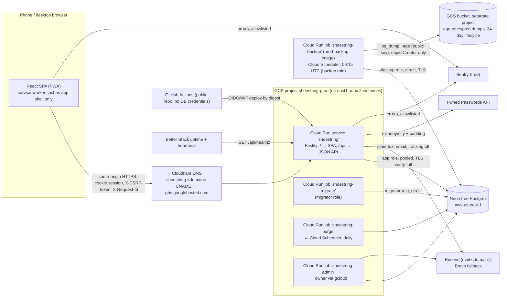

# Architecture
Owner: architect. Keep this current; every agent reads it before starting work.
Details live in docs/contracts/ (source of truth between areas) and docs/decisions/ (why).

## Purpose and users
Shoestring is a mobile-first budgeting PWA for an invite-only beta of fewer than 10 US users. People set **monthly limits per category**, log transactions by hand in seconds on their phone (optionally split across categories), and see what's left this month. A household can share one budget: one owner plus equal members, and the owner can hand ownership to another member. Great means three things:
- quick-add takes 3 taps and under 10 s, one-handed
- totals are always right
- financial data never leaks between budgets, into logs, or onto the device

**Running cost is $0** (hard constraint).

Out of the MVP: accounts and transfers, recurring transactions, CSV import, bank sync, multi-currency, offline writes, notifications beyond email, native apps.

## Critical user journeys
test-engineer covers each journey end to end (phone and desktop projects); security-reviewer prioritizes them.
| # | Journey | Acceptance (summary) |
|---|---|---|
| J1 | **Onboard on a phone**: open the emailed sign-up invite → set name and password → create a first budget from starter categories with monthly amounts → land on the month overview | One `POST /budgets` creates the budget, categories and this month's plan atomically; works at 320 px wide; budget timezone defaults to the device's; the invite token is removed from the URL before anything else runs |
| J2 | **Quick-add a transaction**: "+" → type amount → tap category → Save (3 taps, < 10 s). Payee, memo and date are optional; so is a split with "left to assign" | Amount field opens the numeric keypad; date defaults to today in the budget timezone; Save retries safely with the same Idempotency-Key; nothing typed is lost on failure; splits must sum (`SPLITS_DO_NOT_SUM`) |
| J3 | **Month status**: planned, spent and remaining per category and in total; overspending visible without relying on colour | Numbers come only from `GET …/summary`; a refund reduces spent; month boundaries follow the budget's calendar dates |
| J4 | **Review and fix**: the month's transactions grouped by day, filter by category, edit (incl. splits) and delete | Cursor pagination; edit conflicts show 409 `VERSION_CONFLICT` and never overwrite silently; deletes update totals immediately |
| J5 | **Copy last month's plan** into a new month, then adjust | `POST …/plan/copy-previous` fills only empty categories by default; archived categories are skipped |
| J6 | **Invite a partner**: owner invites by email (re-auth) → partner sees and accepts → both see the same budget and each other's transactions. The partner signed up through an owner-created sign-up invite. Also: the owner transfers ownership, deletes the budget, and undoes the deletion | Non-members get 404; members edit transactions, limits and categories; only the owner invites, removes, renames, transfers, deletes and restores; members are emailed on deletion and restore |
| J7 | **Secure my account**: enable TOTP or a passkey → save recovery codes → sign out → sign in with the second factor; a password reset by email then also demands the second factor; a "this wasn't me" link undoes an email change | MFA is optional but, once on, never bypassed by email reset; sensitive actions ask for re-auth; new sign-ins are emailed; the device list can revoke sessions; sessions end after 90 days at most |

## System overview

## Components and boundaries
| Component | Path | Owner | Talks to | Contract |
|---|---|---|---|---|
| SPA (React + TS + Vite, React Aria/Radix, Tailwind) | frontend/ | frontend-engineer | API (same origin) | api.openapi.yaml, errors.md, auth.md |
| API client and types (generated from api.openapi.yaml with openapi-typescript + openapi-fetch) | frontend/src/api/ (generated, never edited) | frontend-engineer | — | api.openapi.yaml |
| API server (Node 24, Fastify, zod) and static SPA serving: `dist/server.js` | backend/ | backend-engineer | DAL, email, HIBP, Sentry | api.openapi.yaml, auth.md, errors.md |
| Admin CLI: `dist/admin.js`, run as Cloud Run jobs | backend/ | backend-engineer | DAL, email | admin-commands.md |
| Test hooks (dev entry only, never in `dist/`) | backend/ | backend-engineer | DAL | test-hooks.md, ADR-0009 |
| Migrations (dbmate, plain SQL), seeds, DAL (Kysely, `@shoestring/db` workspace package), DB roles `migrator`/`app`/`backup` | db/ | data-engineer | PostgreSQL | data-model.md |
| Integration, contract, permission, e2e, visual, a11y tests | tests/ | test-engineer | everything | all contracts |
| Pipeline, Makefile, compose, Dockerfile, root workspace files | .github/, Makefile, Dockerfile*, docker-compose*, root `package.json`/`pnpm-workspace.yaml` | ci-engineer | — | ADR-0001, 0008, 0009 |
| Hosting, Cloud Run service and jobs, backups, scheduling, monitoring, runbooks | infra/, deploy/, observability/, docs/runbooks/ | sre | GCP, Neon, Sentry, Better Stack, Resend, Cloudflare | ADR-0007, admin-commands.md |
| Threat model, findings, checklist, privacy notice | docs/security/ | security-reviewer | — | auth.md, data-model.md |

### Workspace interface (ratified for ci-engineer)
- One pnpm workspace (pnpm pinned, supply-chain settings in ADR-0008) with packages `frontend`, `backend`, `db` (`@shoestring/db`) and `tests`. The backend depends on `@shoestring/db`; nothing imports from `frontend`.
- **Every package** has the scripts `lint`, `typecheck` and `test`, plus `build` and `dev` where relevant. The Makefile and CI call only these.
- `backend build` produces `dist/server.js` and `dist/admin.js` (and nothing from the test-hooks module).
- `db` adds `migrate` and an **idempotent** `seed`.
- `tests` adds `e2e` and `visual`.
- Packages with native dependencies (e.g. `argon2`) must be allowlisted in `onlyBuiltDependencies`. Every other dependency build script is blocked.
- Backend and frontend each generate TypeScript types from api.openapi.yaml, and CI fails if the generated files are stale, so contract drift is a compile error.

## Cross-cutting decisions
- **Same origin.** One host, `https://shoestring.<domain>`, served by Cloud Run domain mapping. The SPA is under `/` and the API under `/api`. No CORS.
  - **Caching:** one container serves both. Hashed assets get `Cache-Control: public, max-age=31536000, immutable`; `index.html`, `manifest.webmanifest` and `sw.js` get `no-cache`.
  - **SPA fallback:** every non-`/api` GET that accepts `text/html` falls back to `index.html`.
  - **Local dev:** the Vite dev server proxies `/api` to `API_PROXY_TARGET`, so the browser still sees one origin.
  - **Not used:** Firebase Hosting in front (it strips cookies other than `__session`; ADR-0007).
- **Auth.** Server-side sessions in an httpOnly `__Host-` cookie, SameSite=Strict, 30-day sliding expiry with a 90-day absolute cap. CSRF and Host checks plus `X-CSRF-Token`. Optional TOTP/passkey MFA with a per-user failure budget. Re-auth for sensitive actions, including sharing and ownership transfer. Invite-only sign-up. Admin powers only through Cloud Run jobs. See auth.md and ADR-0003.
- **Authorization.** Deny by default. Every route explicitly declares `x-session` / `x-budget-role` / `x-reauth` in the contract, and the server refuses to start if any route lacks them or if a `{budgetId}` path is not budget-scoped. Budget access goes through a `BudgetScope` that only the membership check can create, enforced by lint/Semgrep rules. Non-members get 404. See auth.md §12, ADR-0006 and ADR-0010.
- **Errors.** One `ErrorBody` everywhere, with a required `requestId` and per-field `details` for `VALIDATION_FAILED`, in a fixed check order. See errors.md.
- **Money and time.** Integer USD cents end to end, with no floats anywhere, including the frontend (parse typed input straight to cents). Transaction dates are calendar `DATE`s; months are `YYYY-MM`; "today" and "current month" follow the budget's IANA timezone. See ADR-0005.
- **Writes over flaky mobile networks.** Creating a transaction or a budget requires an `Idempotency-Key`. Edits carry `version` and fail with 409 on conflict. Lists use MAC'd opaque cursors. There is no offline queue. See ADR-0002.
- **No financial data on the device.**
  - The service worker precaches only the app shell (HTML, JS, CSS, fonts, icons) and uses network-only for `/api/*`.
  - API responses are `Cache-Control: no-store`.
  - Query caches live in memory only (no localStorage/IndexedDB persistence).
  - Sign-out clears them and does a full `location.replace('/signin')`.
  - **bfcache (F-32):** on `pageshow` with `event.persisted`, the SPA re-checks `GET /api/auth/session` and clears all in-memory state **before** rendering anything. If the check fails, it shows the sign-in screen.
  - Allowed in localStorage: the theme preference and the last-used budget ID only.
- **Request IDs and logging.**
  - **Request IDs:** the SPA sends `X-Request-Id` on every call. The backend echoes it or generates one, logs it on every line, and returns it on every response and in `ErrorBody`.
  - **Log lines** are JSON (pino) with: time, level, requestId, route template, method, status, latency ms, opaque userId, budgetId, error code.
  - **Never logged:**
    - request or response bodies, and query strings (only the route template is logged)
    - cookies, `X-CSRF-Token`, `Authorization`, tokens
    - emails, display names, IPs, user agents
    - amounts, payees, memos, budget, category or passkey names
    - `request_hash`
  - **Error serialization (F-07)** goes through an allowlist (errors.md "Logging rules"): SQLSTATE, constraint, table and column, plus stack frames. It never includes DB `message`/`detail`/`where`/`hint`, query parameters, or zod "received" values.
  - The redaction config and its unit test, which includes a DB-error fixture, are approved by security-reviewer.
- **Error tracking (F-06, F-07).** Sentry free tier for frontend and backend.
  - **SDK settings:** `sendDefaultPii: false`; no session replay; `tracesSampleRate: 0`.
  - **Breadcrumbs:** DOM and console breadcrumbs off; fetch breadcrumbs keep the URL path only.
  - **URL scrubbing:** `beforeSend` and `beforeBreadcrumb` strip `#…` and `?…` from every URL.
  - **Server SDK:** sends no request headers, cookies or bodies.
  - **Project settings (sre):**
    - "Prevent storing of IP addresses" on
    - data scrubber on, with extra fields `token`, `password`, `code`, `email`, `payee`, `memo`
    - inbound filters and a per-key rate limit
  - **Event contents:** requestId, opaque user ID, route, browser and release (`APP_RELEASE`) only.
  - **Source maps:** uploaded privately by CI.
- **Security headers (all responses, F-23).**
  - `Strict-Transport-Security: max-age=31536000; includeSubDomains`
  - `Content-Security-Policy: default-src 'self'; script-src 'self'; style-src 'self'; img-src 'self' data:; font-src 'self'; connect-src 'self' https://o<id>.ingest.us.sentry.io; worker-src 'self'; manifest-src 'self'; frame-ancestors 'none'; base-uri 'none'; form-action 'self'; object-src 'none'; report-to csp`
  - `Reporting-Endpoints: csp="<Sentry CSP report URL>"`
  - `X-Content-Type-Options: nosniff`, `Referrer-Policy: no-referrer`
  - `Cross-Origin-Opener-Policy: same-origin`, `Cross-Origin-Resource-Policy: same-origin`
  - `X-Frame-Options: DENY`, `Permissions-Policy: camera=(), microphone=(), geolocation=()`

  `connect-src` names the exact Sentry ingest host. Fonts are self-hosted, and there are no third-party scripts. React Aria is preferred for primitives that would otherwise inject `<style>` elements (Radix Dialog scroll lock, ScrollArea). e2e fails on any `securitypolicyviolation`. `script-src` is never relaxed; any style exception needs security sign-off. The backend rejects any `Host` other than the `APP_ORIGIN` host, except on the health endpoints.
- **Config.** Environment variables only, each documented in `.env.example` (ci-engineer maintains the file; backend-engineer supplies the list). The server validates config with zod at startup and fails closed.
  - **Runtime (service):**
    - `NODE_ENV` (required; the production image sets `production`)
    - `HOST`, `PORT`, `APP_ORIGIN`, `STATIC_DIR` (built SPA directory)
    - `DATABASE_URL` (app role, pooled, `sslmode=verify-full`)
    - `COOKIE_SECURE`
    - `APP_KEYRING`: a key-versioned JSON keyring, `{"current":"k2","keys":{"k1":"<base64 32 bytes>",…}}`, validated at startup. It replaces `MFA_ENCRYPTION_KEY` and `THROTTLE_KEY`; HKDF subkeys for TOTP, recovery codes, throttle keys and cursors (data-model.md "Application keyring"). Mounted only on the service and the `rewrap-mfa` job.
    - `WEBAUTHN_RP_ID`, `WEBAUTHN_RP_NAME`
    - `EMAIL_TRANSPORT` (`console` | `test` | `provider`), `EMAIL_API_KEY`, `EMAIL_FROM`, `EMAIL_DAILY_QUOTA` (the provider's daily send limit; 100 for Resend free; drives the priority threshold in auth.md §14)
    - `HIBP_ENABLED`, `SENTRY_DSN`, `APP_RELEASE` (git SHA), `LOG_LEVEL`
    - `TEST_HOOKS` (dev entry only)
  - **Migrate job only:** `MIGRATOR_DATABASE_URL` (direct endpoint). It is never given to the service or the admin jobs.
  - **Local and test only:** `DATABASE_ADMIN_URL` (creates roles, resets databases), `API_PROXY_TARGET` (Vite dev proxy). Local and test database passwords are generated at setup and never committed; `.env.example` contains no literal passwords (owner ruling, round 2).
  - **Backup job only:** the backup DB URL (`backup-database-url`, `backup` role) and the `age` public recipient. The job runs its own `prod-backup` image (ADR-0007 constraint 10).
  - **Frontend build (public):** `VITE_SENTRY_DSN`, `VITE_APP_RELEASE`.
  - **Refused in production:**
    - `COOKIE_SECURE=false`, `TEST_HOOKS=1`, `HIBP_ENABLED=false`
    - `EMAIL_TRANSPORT≠provider`, a missing `EMAIL_DAILY_QUOTA`, or an invalid `APP_KEYRING`
    - a missing `NODE_ENV`
    - a `DATABASE_URL` without `sslmode=verify-full`
- **Email.** One adapter interface with three transports: console (local dev), test (in-memory outbox; test-hooks.md), and provider (Resend on `mail.<domain>`, Brevo as fallback).
  - Messages are **plain text only**, with click and open tracking disabled and links built only from `APP_ORIGIN`.
  - User text is escaped, never linkified, and length-capped (F-29). Emails never contain financial data.
  - Sends are counted per UTC day: past 60% of `EMAIL_DAILY_QUOTA` only priority mail goes out and the owner is alerted; at 100% all mail stops (auth.md §14, F-09).
  - Provider timeout is 700 ms. Enumeration-sensitive endpoints answer at a fixed 1 s (F-22).
- **Health (sre proposal, adopted).**
  - `GET /api/healthz`: the process is up; no DB access. This is the Cloud Run **startup probe** and the uptime monitor's target, so neither wakes Neon, and a Neon outage does not take the SPA down.
  - `GET /api/readyz`: the DB is reachable within 1 s, migrations are applied, and every key ID referenced in the database is present in `APP_KEYRING`. It is the **pre-traffic deploy gate**, called on the tagged revision before traffic moves. It is public, so a failure returns 503 `UNAVAILABLE` with a generic message that never names key IDs or the failing check; details go to the server log.
  - Both are exempt from the Host check.
- **Migrations.** Run by the `shoestring-migrate` Cloud Run job (`migrator` role) as a release step before new code takes traffic. Migrations are expand/contract (backward compatible with the previous release), so a rollback never needs a down-migration.
- **Environments.** Local (docker compose via OrbStack: Postgres, backend and frontend with hot reload) and production. No staging; CI uses throwaway Postgres. Rollback = move traffic back to the previous revision or image digest.
- **Scheduled jobs and admin.**
  - **Purge:** Cloud Scheduler → `shoestring-purge` daily at 08:00 UTC; counts-only output; Sentry cron monitor.
  - **Backups:** Cloud Scheduler → Cloud Run job `shoestring-backup` at 09:15 UTC, after the purge. It runs the dedicated non-root `prod-backup` image (alpine, `postgresql17-client`, `age`, `curl`), not the app image. It streams `pg_dump` (`backup` role, credential in Secret Manager) through `age` (public key only), then uploads create-only (`ifGenerationMatch=0`) to GCS in a separate project, with a 34-day lifecycle and a Better Stack heartbeat. No database credential is held by GitHub (ADR-0007 constraint 10).
  - Cloud Scheduler uses 2 of its 3 free jobs; Secret Manager holds 5 secrets (free tier: 6).
  - **Keyring rotation:** owner-run `rewrap-mfa` job (admin-commands.md).
  - **Admin commands:** run by the owner via `gcloud run jobs execute shoestring-admin` (admin-commands.md); never in GitHub Actions.

## Non-functional requirements
| Area | Target | Verified by |
|---|---|---|
| First load | LCP < 2.5 s on a mid-range Android phone (Moto G Power class) over 4G (Lighthouse mobile throttling), warm server, first visit | Lighthouse CI against the production build (ci-engineer) |
| Repeat load | App shell from the service worker; usable UI < 1 s; data after the API responds | e2e timing check |
| JS budget | Initial route ≤ 150 KB gzip JS, ≤ 30 KB gzip CSS, ≤ 2 self-hosted woff2 fonts ≤ 60 KB total. MFA, QR, WebAuthn and chart code are lazy-loaded. | size check in `make check` (ci-engineer) |
| API latency (warm, server-side) | p95 ≤ 300 ms for reads (incl. month summary with 2,000 transactions in the month), ≤ 500 ms for writes, ≤ 1 s for login/reauth (argon2id) | integration perf test + EXPLAIN checks; production logs |
| Cold start | First API response after idle ≤ 3 s p95 (Cloud Run start + Neon wake). Measured by sre at first deploy (ADR-0007 V9) | sre measurement |
| Quick-add | 3 taps, < 10 s, one-handed, on a 375 px wide phone | e2e journey J2 + owner's manual phone check |
| Accessibility | WCAG 2.2 AA; touch targets ≥ 44 × 44 px; inputs ≥ 16 px font (no iOS zoom); colour never the only signal; charts have table equivalents | axe in e2e (fail on serious/critical) + manual VoiceOver/TalkBack checklist per release |
| Browsers | iOS Safari 16.4+ (tab and installed PWA), current Android Chrome (last 2 versions); current desktop Chrome, Safari, Firefox and Edge best effort | Playwright WebKit (iPhone), Chromium (Pixel), desktop Chrome; manual check on the owner's phone |
| Correctness | Totals always right: 100% branch coverage on money, split and month logic; DB-enforced split sums | coverage gate in `make check` |
| Isolation | No cross-budget reads or writes | permission tests generated from the contract extensions; two-household DAL suite; Semgrep rules |
| Durability | RPO 24 h (nightly encrypted dump plus any Neon restore window); backups expire within 35 days (34-day lifecycle); RTO best effort, target 4 h; one restore drill before launch, including the post-restore steps | sre runbook + drill record |
| Availability | Best effort on free tiers; SLO "record a transaction succeeds" 99.5% / 30 days. Alerts: site down, error spike, missed backup, failed purge, billing, email budget (email, plus push via the Sentry and Better Stack apps) | Better Stack, Sentry, GCP budget alert |
| Cost | **$0/month.** Free tiers only; Cloud Billing spend cap plus a $0.01 budget alert; max 2 instances. Accepted residual: a request flood could cost up to the low tens of dollars before the cap acts (ADR-0007 R1). Any change that could incur cost needs an ADR. | sre cost sheet |
| Data rights | CSV export; account deletion with a 30-day grace period, then purge; purged data gone from backups within 35 days | integration tests + purge job |

## Contracts and decisions index
Contracts: api.openapi.yaml · data-model.md · auth.md · errors.md · admin-commands.md · test-hooks.md.

ADRs:
- 0001 stack
- 0002 PWA, online-only
- 0003 auth, sessions and optional MFA
- 0004 budgeting method and month rules
- 0005 money, currency and time
- 0006 shared-budget tenancy and authorization
- 0007 hosting on Cloud Run + Neon at $0
- 0008 pnpm supply-chain settings
- 0009 e2e against dev servers with test hooks
- 0010 budget lifecycle: ownership transfer, self-service restore and owner tooling
