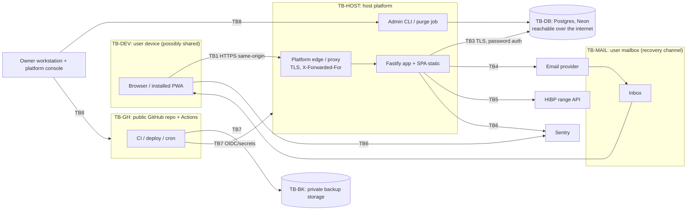

# Threat model
Owner: security-reviewer. Updated whenever a new endpoint, data flow, integration, or role appears.

- **Version:** v2.3 (2026-11-13), after the first code review (the data layer, §5.6). v2 was the re-review of contract revision 2; v1 (2026-11-12) the first design review. The backend and frontend do not exist yet.
- **Sources reviewed:** ARCHITECTURE.md; contracts auth.md (rev 2), data-model.md, errors.md, api.openapi.yaml, admin-commands.md, test-hooks.md; ADR-0001 to ADR-0010; mvp-planning/README.md and 01–10 (10 holds the owner's rulings OD-1 to OD-8 and the hosting decision).
- **Statuses in §5:** each row's *mitigation* reflects revision 2. Where a row cites a finding, that finding's current status (`contract-fixed`, `partially-fixed`, `open`) is in the FINDINGS.md summary table, which is the source of truth. New threats from revision 2 are T80 to T92 (§5.4).
- **Findings:** each `F-xx` below is described in [FINDINGS.md](FINDINGS.md). The implementation checklist is in [mvp-security-checklist.md](mvp-security-checklist.md).
- **Status legend:** *designed* means the contract mitigates it and the implementation must be verified · *F-xx* means a gap, with a finding · *R-x* means an accepted or proposed residual risk (see "Open risks").

## 1. System summary and assumptions
Shoestring is a same-origin SPA plus a JSON API (`https://shoestring.<domain>`, `/api`) in one container.

Hosting (ADR-0007, accepted 2026-11-12):
- **Runtime:** Cloud Run in us-east1, max 2 instances, scale to zero, Cloud Billing spend cap, behind Cloud Run domain mapping with Cloudflare DNS in DNS-only mode. The fallback is a Cloudflare proxy, which needs security sign-off first.
- **Database:** Neon free Postgres (aws-us-east-1), reachable from the internet.
- **Other services:** Resend email on `mail.<domain>` (Brevo as fallback), Sentry free, Better Stack and the HIBP range API.

Operations:
- CI/CD runs on GitHub Actions in a **public** repository, deploying through WIF pinned to `main` and the environment.
- Nightly backups run from a GitHub Actions job and land in a private GCS bucket in a separate project.
- Admin powers exist only as CLI commands, run by the owner as **Cloud Run jobs** in the private prod project.

Users: the beta is invite-only, with fewer than 10 US users who mostly know the owner personally.

Assumptions this model depends on (if one changes, revisit):
1. A1: users are invited personally by the owner, so the owner can verify identity out of band (needed for `reset-mfa`).
2. A2: the only free sign-up path is an owner-created invite. An attacker therefore cannot just create a Shoestring account. Several invitation threats rely on this.
3. A3: no file uploads, no user-supplied URLs, and no server-side fetching of user-controlled destinations. There is no SSRF surface beyond the fixed HIBP and email-provider hosts.
4. A4: no bank credentials or tokens, card numbers or government IDs are stored (owner decision).
5. A5: the owner's shared apex domain hosts other services. Sibling subdomains are **same-site, but not same-origin**, and are not trusted.
6. A6: free-tier terms (quotas, log retention, IP allow-listing) can change without notice.

## 2. Assets and data classification
### 2.1 Data assets
Classes follow data-model.md "Data classification" (PII, Sensitive, Secret, Internal). Rows marked † are classifications this review adds (F-07, F-26).

| Asset | Class | Where it lives | Legitimate readers | Impact if disclosed or altered |
|---|---|---|---|---|
| Transactions (amount, payee, memo, date, splits) | Sensitive | `transactions`, `transaction_splits`; API responses; CSV export; backups | Budget members | Financial privacy breach for a household; tampering silently breaks "totals are always right" |
| Plans, budget and category names | Sensitive | `plan_entries`, `budgets`, `categories` | Budget members (budget name also goes to invitees) | Same as above, lower impact |
| Email address | PII | `users`, `signup_invites`, `budget_invitations`, `user_tokens.new_email`; email provider; backups | The user; the budget owner, for invitees | Phishing and enumeration; the email address is also the account-recovery channel |
| Display name | PII | `users`; members list; CSV `created_by`; invitation emails | Co-members, invitees | Low |
| Client IP | PII | `security_events.ip` (90 days); **host platform request logs** †; Sentry, unless IP storage is disabled † | Owner (incident response) | Location tracking |
| User agent / device label | PII (low) | `sessions.device_label` (coarse); **host platform request logs (raw UA)** † | The user | Low |
| Passkey name | PII (low) | `webauthn_credentials.name` | The user | Low |
| Password hash (argon2id) | Secret | `users.password_hash`; backups | Backend only | Offline cracking; mitigated by argon2id and the breached-password check |
| Session token | Secret | Cookie only (DB holds SHA-256) | Browser and backend | Full account access for up to 30 days, sliding (no absolute cap: R-3) |
| CSRF token | Secret | `sessions.csrf_token` (plaintext); SPA memory | Backend, SPA | Useless without the session cookie |
| TOTP secret | Secret | `totp_credentials.secret_ciphertext` (AES-256-GCM) | Backend with `APP_KEYRING` (`totp-v1`) | Defeats MFA. Encryption keeps a DB-only or backup-only leak from exposing it |
| Recovery-code hashes | Secret | `recovery_codes.code_hash`: HMAC-SHA-256 with the `recovery-code-v1` subkey (rev 2, F-04) | Backend | Offline brute force now needs `APP_KEYRING` too, the same bar as TOTP |
| Email-change cancel tokens | Secret | `user_tokens` (`email_change_cancel`, 24 h; exempt from revocation) | The holder of the *old* mailbox | Reverts the account email within 24 h; an earlier token always wins (F-33 fixed); residual R-11 accepted |
| Admin-command arguments (target email) | PII | Cloud Run job execution records and Cloud Audit Logs (private prod project) | Owner | Kept outside the app's deletion promise (R-12) |
| One-time token hashes (sign-up, reset, email change) | Secret | `signup_invites`, `user_tokens` | Backend | Low (256-bit tokens, hashed) |
| Plaintext one-time tokens | Secret | **Email body and links; email provider logs and click-tracking †; URL fragment, browser history and Sentry page URLs †** | The addressee | Account creation, password reset or email takeover within the expiry window (F-06) |
| WebAuthn challenges | Secret | `webauthn_challenges` | Backend | Low (single use, 5 minutes) |
| `idempotency_keys.request_hash` | Internal (derived from Sensitive) † | DB, 24 h | Backend | Hash of a body that contains payee and memo; low entropy for amounts. Never log it |
| `security_events` (audit log) | Internal + PII (IP) | DB, 90 days | Owner | Tampering hides an intrusion (F-26) |
| Backups (`pg_dump`, encrypted) | Contains all of the above | Private backup storage, 35 days | Owner | Full breach if storage is public or the key leaks (F-17) |

### 2.2 Operational secrets and control assets
| Asset | Held by | Impact if compromised |
|---|---|---|
| `DATABASE_URL` (app role) | Host secret store; jobs that need it | Read/write of all user data, bypassing the API |
| `DATABASE_MIGRATOR_URL` | Release/migration step **only** (F-28) | DDL, ownership of the schema |
| `APP_KEYRING` (replaces `MFA_ENCRYPTION_KEY` and `THROTTLE_KEY`; versioned, HKDF subkeys) | Secret Manager; mounted only on the service and `shoestring-rewrap-mfa`; offline escrow in a separate vault | Combined with a DB leak: decrypts every TOTP secret, makes recovery codes brute-forceable, and makes rate-limit keys reversible |
| `EMAIL_API_KEY` | Host secret store | Phishing from the app's own sending domain; burns the free quota |
| Sentry auth token (source-map upload) | CI environment secret | Low (the repo is public), but it allows event tampering |
| Deploy credentials (OIDC/WIF or a token) | GitHub environment | **Code execution in production** |
| Backup encryption private key (`age`) | Owner, offline | Decrypts every backup |
| Owner's GitHub, host, Neon, email-provider, Sentry, DNS-registrar and domain-email accounts | Owner | **Each one is equivalent to full production compromise** (F-03) |
| Source-code integrity (public repo, dependencies, Actions) | GitHub, npm | Backdoor shipped to production (F-16) |
| Sending-domain reputation (SPF/DKIM/DMARC) | DNS | Spoofed "reset your password" phishing; lost deliverability means lost recovery |

## 3. Actors
| Actor | Capability | Typical goal |
|---|---|---|
| Internet attacker | Anonymous HTTP; can host pages; may control a sibling subdomain if one of the owner's other DNS records is dangling | Credential stuffing, enumeration, CSRF, denial of service or denial of wallet |
| Phisher / credential stuffer | Holds a user's password (MFA is optional: R-1) | Take over the account and persist |
| Mailbox attacker | Controls or reads a user's mailbox | Reset the password; confirm an email change |
| Device-access attacker (ex-partner, family member) | Brief access to an unlocked phone with a live 30-day session | Read or export data; share it with themselves; persist |
| Malicious or curious co-member | A legitimate member of a shared budget (an equal member) | Alter or wipe household data, export everything (R-4) |
| Other beta user (non-member) | Has a valid account | Cross-budget reads or writes; invitation abuse |
| Third-party insider or breach | Email provider, Sentry, host, Neon, HIBP | Read whatever data reaches them |
| Supply-chain attacker | Malicious npm package or Action; a fork PR | Run code in CI or production; steal secrets |
| Owner as operator (mistakes) | Prod credentials, CLI | Wrong-target `reset-mfa`; PII in logs; a botched restore |

## 4. Trust boundaries

| ID | Boundary | What crosses it | Main controls |
|---|---|---|---|
| TB1 | Browser to edge/app | Cookie, CSRF token, JSON bodies, one-time tokens (in bodies) | TLS + HSTS, `__Host-` Strict cookie, Origin/Sec-Fetch-Site + CSRF token, CSP, schema validation |
| TB2 | Edge/proxy to app | Client IP (X-Forwarded-For), Host | `trustProxy` set to the platform's hop count (F-08); Host header check (F-23) |
| TB3 | App/CLI/backup job to Postgres | All data | Separate `app`/`migrator` roles, TLS `verify-full`, strong random passwords; the DB is internet-reachable on free tiers (F-28) |
| TB4 | App to email provider to mailbox | Email addresses, plaintext one-time links, budget and display names | No financial data; tracking off (F-06); escaped plain text (F-29); quota guard (F-09); SPF/DKIM/DMARC |
| TB5 | App to HIBP | 5 hex characters of SHA-1(password); server IP | k-anonymity, `Add-Padding`, 2 s timeout, fallback list (F-24) |
| TB6 | App/SPA to Sentry | Errors, stack traces, URLs, breadcrumbs | Scrubbing allowlist, no replay, IP storage off, fragment stripping (F-06, F-07) |
| TB7 | GitHub Actions to host, DB and backup storage | Deploy identity, DB creds for cron jobs, backups | Environment-scoped secrets, OIDC attribute conditions, SHA pins, no secrets on fork PRs (F-16, F-17, F-02) |
| TB8 | Owner to admin CLI and consoles | Prod credentials, target emails | Platform-side execution, no PII in output, MFA on every operator account (F-02, F-03) |
| TB9 | Backup storage | Full encrypted dumps | Private, write-only CI credential, expiry of 35 days or less, offline key (F-17) |
| TB-DEV | The user's device | Session cookie, in-memory data, downloaded CSV, URL history | No API data cached, `no-store`, sign-out clears state, bfcache handling (F-32) |
| TB-TEN | **Between budgets** (logical) | IDs in paths and bodies, cursors, idempotency keys | `BudgetScope`, composite FKs, 404 for non-members, generated isolation tests (F-18) |
| — | **Between co-members of one budget** | Everything in the budget | **None by design.** Members are equal; owner-only actions are limited to sharing and deletion (R-4) |

## 5. STRIDE analysis
S = Spoofing, T = Tampering, R = Repudiation, I = Information disclosure, D = Denial of service, E = Elevation of privilege.

### 5.1 Journeys
| ID | Journey / area | Threat | STRIDE | Mitigation in contract | Status |
|---|---|---|---|---|---|
| T1 | J1 sign-up | Sign-up token guessed or replayed | S | 32-byte token, hashed, 7-day expiry, single use in the same transaction, re-issue revokes the old one, `signup` rate limit, one `INVITATION_INVALID` code | designed |
| T2 | J1 | Sign-up token leaks through the URL fragment to Sentry, browser history or synced tabs, or through the email provider's click tracking | I | Fragment only (not sent to the server or in Referer) | **F-06** |
| T3 | J1 | Login CSRF or sign-up CSRF from a cross-site page | S | Exact Origin match (Sec-Fetch-Site fallback) on public unsafe endpoints; JSON only | designed |
| T4 | J1 | Session fixation at sign-up or login | S | New session row and cookie on sign-up, login and MFA completion; old session revoked | designed |
| T5 | J1 | Weak or breached password chosen | S | 12–128 characters, HIBP plus a 100k fallback list, not equal to the email | designed (F-24 minor) |
| T6 | J1 / J2 | Budget creation spam fills storage | D | 10 budgets per user, 120 writes/min per user, 64 KiB bodies | designed |
| T7 | J2 quick-add | Write into another budget, or reference another budget's category in a split | T/E | Membership check produces `BudgetScope`; composite FKs `(budget_id, id)`; sub-resources looked up within the scope | designed; error mapping and enforcement gaps **F-18** |
| T8 | J2 | Idempotency key used to read another budget's or a deleted resource ("replay returns current state") | I | PK `(user_id, key)`; request hash includes path params; membership check (step 8) runs before replay (step 12) | designed; replay must go through scope and respect soft delete (**F-18**) |
| T9 | J2 / J4 | Stored XSS through payee, memo, category, budget, display or passkey names shown to co-members | E/I | React escaping; CSP `script-src 'self'`, no third-party scripts | designed; lint rules in checklist; CSP style details **F-23** |
| T10 | J2 / J4 | Payee, memo or amounts leak into logs or Sentry, including through DB error details on 5xx | I | Field redaction list; no bodies logged | **F-07** |
| T11 | J3 summary | Summary includes another budget's rows | I | Scoped query; generated isolation tests | designed (F-18) |
| T12 | J4 list | Cursor or `categoryId` filter from another budget used to read it | I | Every query filtered by `scope.budgetId`; cursor bound to its filters | designed; bind cursor to budget and filters with a MAC (F-18) |
| T13 | J4 | Lost update by a co-member | T | `version` + 409 | designed |
| T14 | J4 | Co-member wipes or alters history (soft delete, overwrite on copy-plan) with no undo | T/R | Soft delete for 30 days; `updated_by_user_id` | **R-4** (accepted risk proposed); restore path F-14 |
| T15 | J5 copy plan | Copies from another budget | I/T | Scoped | designed |
| T16 | J6 invite | Guessing an invitation ID to accept someone else's invitation | E | No token; accept requires `invitation.email == caller.email` (verified); others get 404 | designed |
| T17 | J6 | Device-access attacker or stolen session invites the attacker's own existing account, giving persistent access that survives session revocation and password change | E | Owner-only; rate limits | **F-13** (no re-auth), **F-12** (no notification on acceptance) |
| T18 | J6 | Email change used to claim invitations addressed to an address the attacker controls | E | Email change requires a confirmation token at the new address | designed: proving control of the address is the intended authorization. See §7 |
| T19 | J6 | Invitation flooding or harassment; budget name used to inject phishing text into emails | D/S | 10 pending per budget, 20/budget/day, 30/user/day; notifications only to existing accounts | **F-29**, **F-31** (Low) |
| T20 | J6 | Enumerating whether an email has an account through invitation creation | I | Identical response; 1 s padding | designed; timing caveat **F-22** |
| T21 | J6 | Removed member keeps access | E | Membership checked on every request (no cached roles) | designed |
| T22 | J6 | Compromised owner deletes the shared budget; members cannot recover it | T/D | Re-auth (password only if no MFA); soft delete | **F-14**, F-12 |
| T23 | J7 login | Credential stuffing / phished password, with no MFA | S | Breached-password check, login rate limits, invite-only | **R-1** (accepted 2026-11-12); detective control gap **F-12** |
| T24 | J7 | Brute-forcing TOTP across login, re-auth and password reset | S | 5 per pending session, 20 per user per 24 h on `mfa-verify`, 5 per reset token | **F-05** (counters not unified) |
| T25 | J7 | Offline cracking of recovery codes from a DB or backup leak | S/I | SHA-256, ~50 bits | **F-04** |
| T26 | J7 password reset | Reset used to bypass MFA | E | MFA required at `complete`; passkey challenge bound to the token; 5 failures invalidate it; all sessions revoked | designed (F-05) |
| T27 | J7 email change | Attacker with the password requests an email change; the victim resets the password; the attacker then confirms with the still-valid token and takes over | S/E | Re-auth; notice to the old address | **F-01 (High)** |
| T28 | J7 | Account lockout by sending 10 bad passwords per 15 min for a victim's email | D | Per-email limit, identical for unknown emails | **F-21** (Low) |
| T29 | J7 | Evicting a victim's sessions by creating many `mfa_pending` sessions | D | 20-session cap | **F-20** (Low) |
| T30 | J7 device list | Spoofed device label; attacker revokes the victim's sessions | S/D | Coarse label; password change revokes the others | designed; label from a fixed vocabulary (F-20) |
| T31 | J7 | Stolen cookie valid indefinitely if used every 30 days | S | Sliding expiry, device list, revoke | **R-3** / **F-19** (owner decision) |
| T32 | J7 | Repudiation of security-relevant actions | R | `security_events` (insert-only, no UPDATE) | gaps in coverage and DELETE privilege **F-26** |
| T33 | Account deletion | Deletion request races an invitation acceptance; purge then deletes a budget that now has another member | T/D | Blocked by `OWNS_SHARED_BUDGET`; accept requires an active owner | **F-25** (Low) |
| T34 | Export | Exfiltration through export from a stolen session | I | Re-auth, 10/hour | designed; no security event is recorded for exports, so add `data_exported` (F-26) |
| T35 | Export | Spreadsheet formula injection from a co-member's payee or memo | E (on the victim's desktop) | Prefix `'` on `= + - @ \t \r`; input is trimmed and control characters are banned | designed; apply to every user-text column (checklist) |
| T36 | All unsafe routes | CSRF from a sibling subdomain (same-site, so SameSite does not help) | S | Exact Origin match; `__Host-` blocks cookie tossing; CSRF token | designed |
| T37 | All | DNS rebinding / Host header injection into email links | S/I | APP_ORIGIN config | **F-23** (Host check), **F-30** (local dev) |
| T38 | All | argon2id memory exhaustion; autoscaling drives cost (denial of wallet) | D | Login rate limits | **F-15** |
| T39 | All | Client IP spoofed via X-Forwarded-For, bypassing per-IP limits and forging audit IPs | S/R | "Trusted only as configured" | **F-08** |
| T40 | Email | Email bombing via reset requests exhausts the free daily email quota, blocking recovery for everyone | D | 3 per email per hour (silent), 5 per IP per hour | **F-09** |
| T41 | Device | Back button after sign-out on a shared phone restores financial data from bfcache | I | In-memory cache cleared at sign-out; `no-store` on API | **F-32** (Low) |

### 5.2 Admin CLI, test hooks, backups and CI
| ID | Area | Threat | STRIDE | Mitigation in contract | Status |
|---|---|---|---|---|---|
| T50 | Admin CLI | Social engineering of `reset-mfa`; a mailbox attacker asks the owner by email | S/E | Out-of-band identity check (runbook) | runbook requirements in F-02; **OD-1** |
| T51 | Admin CLI | Emails and the "who had MFA reset" information exposed in public Actions logs or workflow_dispatch inputs; CLI prints emails into platform job logs | I | "May print the target email" | **F-02 (High)** |
| T52 | Admin CLI | Secret sprawl: the CLI loads every server secret, including when it runs in GitHub | I/E | "same environment variables as the server" | **F-02**, F-28 |
| T53 | Admin CLI | `revoke-sessions` / `reset-mfa` leave one-time tokens alive | E | — | **F-01** |
| T54 | Admin CLI | Wrong target or accidental destructive run | T | Type-the-email confirmation; `--yes` only for scheduled runs | designed |
| T55 | Test hooks | `/_test/login` (no password, no MFA) reachable in production | E | Refuse to start with `TEST_HOOKS=1` and `NODE_ENV=production`; separate module | **F-10** (the controls conflict with "one image deployed unchanged") |
| T56 | Test hooks | LAN or DNS-rebinding access to local hooks during phone testing | E/I | Origin match on POST | **F-30** (Low, synthetic data only) |
| T57 | Backups | Dump in public-repo Actions artifacts, downloadable by any signed-in GitHub user | I | ADR-0007 §7 forbids it unless security accepts | **Not accepted**: **F-17** |
| T58 | Backups | Restore resurrects revoked sessions, removed members, old passwords, removed MFA and purged data | E/I | — | **F-11** |
| T59 | Backups | Backup job credential is the app or migrator role | E | — | **F-17** (dedicated read-only role) |
| T60 | Backups | Key loss makes backups useless | D | Owner holds the key | restore drill (sre); F-17 |
| T61 | CI / supply chain | Malicious npm install script or a compromised Action steals CI or deploy secrets | E/I | SHA-pinned Actions, Dependabot without automerge, osv-scanner | **F-16** |
| T62 | CI | Fork PR or `pull_request_target` gets secrets; OIDC trust too broad | E | "No secrets for fork PRs" | **F-16** |
| T63 | Public repo | Committed secret (`.env.production` is not git-ignored today) | I | gitleaks, push protection (planned) | F-28 (ci-engineer task 1 covers it) |
| T64 | Public repo | Open vulnerability details published in FINDINGS.md | I | — | **F-27**, **OD-6** |
| T65 | Operator accounts | Phished owner GitHub/host/Neon/registrar account gives full production compromise | S/E | — (not specified) | **F-03 (High)** |

### 5.3 Third parties
| ID | Third party | Threat | STRIDE | Mitigation | Status |
|---|---|---|---|---|---|
| T70 | Email provider | Provider stores message bodies containing live one-time links; click tracking rewrites links and records full URLs including fragments | I | Short expiries, single use | **F-06** (tracking off) · **R-5** (provider sees addresses and links) |
| T71 | Email provider | Spoofed mail from the sending subdomain used for phishing | S | SPF/DKIM/DMARC (sre) | checklist (DMARC `p=reject` on the subdomain) |
| T72 | Email provider | Quota exhausted or account suspended (complaints), leaving no recovery channel | D | — | **F-09** |
| T73 | Sentry | PII or Sensitive data in events (URLs with fragments, DOM breadcrumbs with labels, DB error details, client IP) | I | "Scrubbing on, no replay, no bodies" | **F-06**, **F-07** |
| T74 | Sentry | Public DSN abused to flood the free quota and blind alerting | D | — | checklist (inbound filters, per-key rate limit) |
| T75 | HIBP | Hash-prefix disclosure; response-size analysis; outage | I/D | k-anonymity; 2 s timeout; fallback list | designed; `Add-Padding` (F-24) |
| T76 | Host | Platform request logs keep client IP, raw UA and full URL (query strings) for their default retention | I | No sensitive values in query strings by design | **R-5**; checklist (no sensitive values in URLs) |
| T77 | Host | Spoofable proxy header; free tier without a hard billing cap (denial of wallet) | S/D | max-instances (C7), billing alerts | **F-08**, **F-15** |
| T78 | Neon | DB reachable from the internet with password auth (no IP allow-list on free tiers); console access = all data | S/I | Separate roles; TLS | **F-28**, **F-03** |
| T79 | Neon | Provider-side branches or PITR copies outlive the 35-day backup promise | I | — | checklist (sre confirms the provider's history window; document it in the privacy notice) |

### 5.4 New in revision 2 (2026-11-13)
| ID | Area | Threat | STRIDE | Mitigation in revision 2 | Status |
|---|---|---|---|---|---|
| T80 | Email-change cancel/revert | Attacker uses a *later* cancel token to delete the victim's earlier cancel link, then keeps the account | S/E | Per-change cancel tokens; an earlier token always wins; one change per 24 h (429) | F-33 contract-fixed |
| T81 | Email-change cancel/revert | Whoever controls the *old* mailbox reverts a legitimate change within 24 h (for example, the user moved away from a compromised mailbox) | S | Sessions revoked; restored address advised to reset | Deviation 2 accepted; both addresses notified; **R-11 accepted 2026-11-13** |
| T82 | Email-change confirm | Confirm without the requester's session | S | Requires an active session of the same user; revoking the requesting session cascades to the token | designed |
| T83 | New-sign-in notice | Attacker signs in with the victim's usual browser/OS (or spoofs the User-Agent) so the notice is skipped | R/S | Notice sent on every successful sign-in | F-34 contract-fixed |
| T84 | MFA failure budget | A credentialed attacker (password, stolen session or mailbox) burns 20 failures and locks the victim out of MFA prompts for 24 h | D | Existing sessions keep working; the user is emailed | Accepted as a side effect of F-05 (part of R-1) |
| T85 | Ownership transfer | Phished owner (re-auth with password only) transfers ownership to a co-conspirator member; the former owner cannot reclaim it | E | Re-auth; target must be an active member; priority notice to all members | Deviation 5 accepted; under R-1/R-4 |
| T86 | Self-service restore | Non-owner restores, or reads the deleted-budget list, through IDs | E/I | Handler checks owner membership and the window; 404 otherwise; no re-auth (it only undoes harm) | designed; `DeletedBudgetScope` (F-36 contract-fixed) |
| T87 | Self-service restore | Owner pending deletion cannot restore; purge re-check pages daily | D | Same rule in both checks; the owner's purge ends the window | F-35 contract-fixed |
| T88 | Admin jobs | Target emails retained in GCP execution records and Admin Activity audit logs (possibly ~400 days), beyond the deletion promise | I | Owner-only project; output never repeats the email | Deviation 3 accepted; **R-12 accepted 2026-11-13** |
| T89 | `security-events` command | IPs copied into Cloud Logging output | I | Same project, 30-day `_Default` retention, owner-run only | Deviation 6 accepted under R-6 |
| T90 | Backup workflow | Compromised action or tool in the GitHub `backup` environment uses the read-all `backup` DB credential to exfiltrate the database | I | Backup now runs as the Cloud Run job `shoestring-backup`; no DB credential or app key enters GitHub (ADR-0007 constraint 6) | Resolved: F-17 contract-fixed |
| T91 | Cloudflare proxy fallback | Forged `CF-Connecting-IP`, or origin reached directly | S | Shared-secret header required; Host check blocks `run.app` | designed; **security sign-off required before switching** |
| T92 | Email budget | Attacker fills the 60 per day budget so resets are dropped | D | Per-email 5 per 24 h caps anonymous reset mail below the budget at this user count; priority mail continues; owner alert | Deviation 4 accepted |

### 5.5 Operations (ops review 2026-11-13)
| ID | Area | Threat | STRIDE | Mitigation in the runbooks | Status |
|---|---|---|---|---|---|
| T93 | Backup job | The deploy identity runs `shoestring-backup` with env overrides (attacker `age` key or bucket, or an attacker database) or deletes it | I/T | No `serviceAccountUser` for the deployer on the backup SA; `objectCreator` create-only | **F-39** (project-level `run.developer` still reaches the job) |
| T94 | Backup restore | A poisoned "newest" object is chosen at restore time | T/E | Only the backup SA can create objects; no overwrite | **F-39** (provenance check in restore.md) |
| T95 | Backup heartbeat | Forged success pings hide failed backups (URL readable from the job config) | R | Monthly check of job execution history | Accepted (ops item 1, owner decision); depends on F-39 |
| T96 | Spend cap | The cap pauses Cloud Run: backups **and purge** stop while the site is down | D/I | No writes while down; the last backup stays within the 34-day lifecycle | Accepted with conditions (ops item 6): manual purge after lifting; no cap on the backup bucket |
| T97 | Operator workstation | Keyring, `age` key or DB URLs leak through Universal Clipboard, clipboard history or process arguments; leftover key file; dev server with test hooks on drill data | I/E | Values never printed; clipboard cleared | **F-40** |
| T98 | Keyring compromise | A burned key must stay live until every user regenerates recovery codes | I | Users asked to regenerate | **F-38** |
| T99 | Admin args | A comma inside an email injects an extra flag into the comma-joined `--args` | T | Owner types the email; `--expect-user-id` | F-02 note (reject `,` in the CLI) |
| T100 | Passkey sync account | Apple ID / iCloud Keychain account recovery (for example SMS) bypasses every passkey-based operator factor | S/E | — | **F-03 partially-fixed: blocking row for the ops PR** |

### 5.6 Data layer implementation (code review 2026-11-13, `feat/db-data-layer`)
New code-level surfaces: the `@shoestring/db` package boundary, the migrate CLI (local role bootstrap, dbmate, roles.sql), the seed CLI, `@shoestring/db/testing` and the database privilege model as built.

| ID | Area | Threat | STRIDE | Mitigation in code | Status |
|---|---|---|---|---|---|
| T101 | Tenant isolation | Backend code mints a `BudgetScope` without a membership check (exported `issueBudgetScope`) or calls raw-`budgetId` DAL internals through a relative import into `db/src` | E/I | WeakSet registry, Semgrep cast bans, two-household suite with a coverage check | **F-41** (Medium; tooling gap in the R-7 condition) |
| T102 | Migrate / testing | A superuser URL that only looks local (`?host=` override) bootstraps roles or TRUNCATEs a remote database; the migrator URL is used without `verify-full` | T/I | Hostname allowlist; refusals never echo the URL | **F-42** |
| T103 | Seed | Demo accounts with an operator-known password are created in production (seed ships in the image, no environment guard) | S/E | example.com addresses; random password unless `SEED_USER_PASSWORD` is set | **F-43** |
| T104 | DB roles | `app` creates temporary objects (default PUBLIC `TEMPORARY`) | E | `pg_temp` pinned last in the only SECURITY DEFINER function | **F-44** |
| T105 | Audit log | `app` deletes or rewrites security events | R/T | INSERT/SELECT only; `purge_security_events()` takes no "now" and uses the database clock | Verified (F-26) |
| T106 | Category delete vs quick-add race | Deferred split→category FK moves the failure to the transaction's COMMIT (raw 23503) | D/I | Pre-check plus `SET CONSTRAINTS … IMMEDIATE` in `deleteCategory`; composite FK unchanged | Accepted deviation; backend F-07 serializer must cover commit-time errors |

## 6. Cross-budget isolation review (every endpoint)
Rule under test: a caller who is not a member of budget B can neither read nor modify anything in B, nor learn that B exists. Every row assumes the contract's check order (errors.md): session, then CSRF, then validation, then membership (404), then role (403), then re-auth, then sub-resource lookup within the scope.

| Endpoint group | Foreign IDs the caller can supply | Leak or tamper vector checked | Result |
|---|---|---|---|
| `GET/PATCH/DELETE /budgets/{b}` | `b` | Non-member and deleted budget both return 404 | OK |
| `GET /budgets` | — | Must list only the caller's memberships (non-deleted) | OK (test) |
| `POST /budgets` (idempotent replay) | Idempotency-Key | Replay of a key whose budget has since been deleted must not return the deleted budget | OK in the DAL: replay goes through `requireMembership` (db test, 2026-11-13) |
| `/budgets/{b}/members`, `DELETE …/members/{u}` | `u` | `u` from another budget gives 404; member removing another member gives 403 | OK |
| `/budgets/{b}/invitations[/{i}]` | `i` | `i` must be looked up within `b`; revoking another budget's invitation gives 404 | OK (test) |
| `/me/invitations`, `…/{i}/accept`, `…/{i}/decline` | `i` | Email match; returns `budgetName` and inviter only for invitations addressed to me | OK (see §7) |
| `/budgets/{b}/categories[/{c}]` | `c` | `c` looked up within `b` | OK |
| `PUT …/months/{m}/plan/{c}` | `c` | Composite FK backstop; must answer 404 before the FK fires (a raw FK error is a 500 whose detail contains values: F-07) | **F-18** |
| `POST …/plan/copy-previous` | — | Source and target are both within `b` | OK |
| `GET …/summary` | — | Scoped aggregation | OK (test with two households) |
| `GET /budgets/{b}/transactions` | `categoryId`, `cursor` | Filter by a foreign category returns nothing; a cursor is meaningless outside its budget. Bind it anyway (MAC over budget and filters) so the error is deterministic | **F-18** (Low part) |
| `POST/PUT /budgets/{b}/transactions[/{t}]` | `t`, `splits[].categoryId` | Foreign category in a split: the error is **unspecified** (404? 400? FK 500?) | OK in the DAL: 400 `VALIDATION_FAILED` before any write; foreign `t` is 404 (isolation suite, 2026-11-13) |
| `POST /me/export` | — | Must iterate memberships through `requireMembership` (not a raw join that could include deleted budgets or ex-memberships) | OK in the DAL: `requireMembership` for each budget (isolation suite, 2026-11-13) |
| `/me/sessions/{id}`, `/me/mfa/passkeys/{id}` | `id` | Other users' IDs give 404 | OK |
| Admin CLI, purge | — | Cross-budget by design; never exposed over HTTP | OK |

## 7. Invitation abuse review
**Sign-up invites** (owner CLI, emailed token):
- *Guessing:* 256-bit token, hashed, rate-limited preview. Not feasible.
- *Reuse:* consumed in the user-creating transaction; a partial unique index allows one open invite per email. OK.
- *Expiry:* 7 days; purged 7 days after expiry. OK.
- *Forwarding:* whoever holds the link can sign up **as the invited email**, so a forwarded link creates an account bound to the original address. That account can still only see budgets it is invited to. Acceptable.
- *Leakage:* fragment-only, but see F-06 (Sentry, history, click tracking).
- *Mistyped address:* the token goes to a stranger, who gets an empty account. Low. The owner can notice from the preview or the account list.

**Budget invitations** (no token; authorized by matching the verified email):
- *Guessing or forging the ID:* requires the caller's email to match, so the result is 404. OK.
- *Reuse:* only `pending` invitations can be accepted; one pending per (budget, email). OK.
- *Expiry:* 14 days, derived. OK.
- *Interaction with email change (architect's item 8):*
  - A user who changes their email from X to Y loses sight of invitations to X ("not transferred"). This is correct: the invitation was for X.
  - A user who changes their email **to** X (proving control through the confirmation token) gains invitations addressed to X. This is by design: control of the address is the authorization. The residual case is a shared mailbox (for example `family@`), where any existing user who can read it can claim the invitation. That is low risk, and **F-12** (notify the budget owner on acceptance) makes it visible.
  - The real interaction risk is **F-01**: a pending email-change token survives the victim's recovery actions. Invitations themselves are not the prize there: an attacker who completes the change sees only invitations addressed to the new, attacker-controlled address. The harm is that the attacker takes over the account, including its existing memberships.
  - *Revision 2:* confirm now needs the requester's session, and the old address gets a 24 h cancel/revert link. A user who changes email to X and then reverts to the old address via the cancel link loses any invitations to X they had not yet accepted. That is harmless. The open flaw is the cancel-token chain (F-33).
- *Enumeration:* identical response and 1 s padding (F-22 caveat). The `accepted`/`declined` status later reveals that an account exists, but only after the invitee chooses to act. Acceptable.
- *Flooding:* bounded by the per-budget and per-user limits, but `MyInvitationList.maxItems: 50` is below the reachable count (F-31).
- *Persistence by a compromised session:* F-13.

## 8. Account deletion and purge review
- **Request:** blocked by `OWNS_SHARED_BUDGET`; revokes pending invitations on owned budgets and all sessions. Gap: it does not lock the owned budgets against a concurrent acceptance (**F-25**). Gap: it does not invalidate open `user_tokens` (a pending email change could still be confirmed during the grace period: **F-01**).
- **Grace period:** sign-in allowed, with a restricted endpoint set (`x-pending-deletion-allowed`). The user still appears in co-members' member lists for 30 days. Acceptable; say so in the privacy notice.
- **Purge, step 1:** deletes owned budgets, then the user. CASCADE removes sessions, MFA, tokens, memberships, idempotency keys and **security_events** (the audit trail goes with the user: acceptable for privacy; incident data should be exported before a purge if an investigation is open). `SET NULL` keeps **content the user authored in other people's budgets** (payees, memos and amounts stay, unattributed). This is correct for the household, but it **must be stated in the privacy notice**. The purge must re-check "no other members" before deleting a budget (F-25).
- **Purge, steps 2–4:** time-based and idempotent. After a restore, rerunning the purge correctly re-deletes anything whose time has passed. It does **not** re-apply event-based changes (revocations, removals, password or MFA changes): **F-11**.
- **Revision 2:**
  - Deletion requests and acceptance now lock the budget rows, and the purge re-checks and fails loudly (F-25 fixed).
  - Ownership transfer gives an owner of a shared budget a way out before deleting their account (ADR-0010).
  - The two checks still disagree about **soft-deleted** shared budgets. Such a budget, owned by a pending-deletion user, cannot be restored by anyone and makes the purge fail daily until it is hard-deleted (F-35).
  - After a restore from backup, `revoke-sessions --all --notify-restore` and then `purge` run before traffic reopens (F-11 fixed). Cancel tokens should be deleted too (F-11 note).
- **Residual copies:** backups (35 days), email-provider logs, Sentry (opaque IDs only, if F-07 is fixed), host request logs (IP and UA), and Neon history or branches (T79). These are stated as 30 + 35 days in data-model.md; the third-party retention periods belong in the privacy notice.

## 9. Open risks
Accepted risks need the owner's sign-off and a date. "Proposed" risks are ones this review believes are reasonable to accept but which **have not been signed off yet**. They are listed for the owner's decision.

| ID | Risk | Why it exists | Mitigations in place | Status |
|---|---|---|---|---|
| **R-1** | **MFA is optional for every user, including the owner's own app account and owners of shared budgets.** A phished, reused or guessed password gives full access to that user's budgets: export, and for owners, sharing (re-auth is password-only without MFA), ownership transfer and budget deletion. Re-auth protects against cookie theft, not against password compromise. | Owner chose beta friction over the security-reviewer's recommendation (meetings 1 and 8; ADR-0003). **Reconfirmed by OD-1** (mvp-planning/10), again against the recommendation to require MFA for owners who share. | Invite-only sign-up; argon2id; HIBP plus the fallback list; login limits and the per-user MFA failure budget; re-auth for sensitive actions including invitations and transfer (F-13); 90-day session cap; revocable device list; priority notification emails for new sign-ins and every security or sharing change (F-12; on every sign-in, F-34 fixed); email-change cancel/revert link (F-01; chain closed, F-33 fixed); self-service budget restore (ADR-0010); admin powers only as Cloud Run jobs; once enabled, MFA is never bypassed by email reset. | **Accepted, owner sign-off 2026-11-12; reconfirmed under OD-1 (mvp-planning/10, 2026-11-12).** The acceptance relies on the F-12/F-13 mitigations; F-33 and F-34 are fixed in the contract (2026-11-13). Revisit before any wider beta (ADR-0003). |
| R-2 | Up to 24 hours of data can be lost in a restore (RPO 24 h on free tiers). | $0 constraint. | Nightly encrypted dumps plus any Neon restore window (V8); restore drill before launch, including the post-restore revocation steps. | Accepted, owner sign-off 2026-11-12 (mvp-planning README) |
| R-3 | A stolen session cookie stays valid for **up to 90 days** if it is used at least once every 30 days. | Long phone sessions (owner decision). | **90-day absolute cap (OD-2)** enforced by DB `CHECK`s; device list; revoke-others; password change revokes others; owner `revoke-sessions`; new-sign-in notice (F-34). | **Reduced by OD-2 (owner, 2026-11-12):** 90-day cap on top of the 30-day sliding expiry. The residual (≤ 90 days) is inherent to the decision |
| R-4 | Co-members are fully trusted. Any member can alter or soft-delete all transactions and plans and export everything, including other members' entries and display names. There is no per-transaction undo, and content a user entered in someone else's budget survives their own account purge. | Owner decision: "owner + equal members" (meeting 1). | `updated_by_user_id`; soft delete for 30 days; optimistic versions; budget-level self-service restore by the owner (ADR-0010). | **Accepted, owner sign-off 2026-11-12 (OD-7)** |
| R-5 | Third parties see PII. Resend sees addresses, names in invitation emails, and live one-time links until they expire. Cloud Run request logs hold client IP, raw UA and URLs for 30 days. HIBP sees a 20-bit hash prefix and the server IP. Sentry sees opaque IDs (IP storage off). Neon holds all data. Cloudflare sees DNS only, or all traffic if the proxy fallback is used. | $0 free-tier services. | No financial data in email, logs or Sentry; short token expiries; tracking off (F-06); Sentry IP storage off (F-07); no sensitive values in URLs; Cloud Run request logs are **excluded** from `_Default` (bootstrap step 4, billing-protection §6), so client IP and raw UA are not kept by our logging. | **Accepted, owner sign-off 2026-11-12 (OD-7)**; list in the privacy notice |
| R-6 | Client IPs are retained in `security_events.ip` for 90 days, and in `security-events` command output in Cloud Logging for 30 days. | Incident response (account-takeover investigation). | PII class; purged at 90 days; deleted on account purge; command output only when the owner runs it. | **Accepted, owner sign-off 2026-11-12 (OD-7)**; covers deviation 6 |
| R-7 | No Postgres RLS. Tenant isolation rests on `BudgetScope`, composite FKs and generated tests. | ADR-0006 (accepted by the owner 2026-11-12). | Branded scope; composite FKs; Semgrep rules; startup route check; two-household isolation suite (F-18 written into ADR-0006 and auth.md §12). Deleted-budget routes need their own scope (F-36). | Accepted with ADR-0006 (2026-11-12), **conditional on F-18 being implemented and passing in `make audit`**. Progress 2026-11-13: DAL parts done (scope assertions, composite FKs, body-ID 400, scoped replay and export, isolation suite with a coverage check, Semgrep cast bans). Still open: F-41 (scope minting and relative imports), the backend startup route check, the cursor MAC |
| R-8 | A single human reviewer; agents carry most of the review load. | Team shape. | `make audit` in CI, branch protection, required checks, security review per diff. | **Accepted, owner sign-off 2026-11-12 (OD-7)** |
| R-9 | Whether the FTC Safeguards Rule (GLBA) or state privacy laws apply has not been assessed by a lawyer. | Out of scope for agents. | US-only free friends-and-family beta, privacy notice, data minimization. | **Accepted as unassessed, owner 2026-11-12 (OD-8)**; revisit before any wider launch |
| R-10 | Denial of wallet: a request flood could cost a few dollars, up to the low tens, before the Cloud Billing spend cap acts (billing data lags). | $0 constraint with a card on file; no free platform rate limiting on Cloud Run (ADR-0007 R1). | Max 2 instances, concurrency 20, argon2 semaphore, app rate limits, Host check blocks `run.app`, spend cap plus a $0.01 alert; Cloudflare proxy as a fallback. V0 (cap behaviour) is still to be verified. | **Accepted, owner sign-off 2026-11-12 (OD-7; ADR-0007 R1)** |
| R-11 | For 24 h after an email change, whoever controls the **old** mailbox can revert it. That includes an attacker in a mailbox the user is moving away from; the attacker can then reset the password if the user has no MFA. | Deviation 2: the revert is the only way back for a phished user (F-01). | All sessions revoked on revert; notices to both addresses (F-33 item 3); one email change per 24 h (F-33 item 2); MFA (when enabled) still guards the password reset. | **Accepted, owner sign-off 2026-11-13** (auth.md §9) |
| R-12 | Admin-command target emails stay in Cloud Run job execution records and Cloud Audit Logs in the private project, possibly for ~400 days (Admin Activity retention cannot be shortened; sre to verify). That can outlive the 30 + 35-day deletion promise. | Deviation 3: Cloud Run jobs take arguments; there is no stdin. | Owner-only project with phishing-resistant MFA (F-03); command output never repeats the email. | **Accepted, owner sign-off 2026-11-13:** target emails stay in GCP job records and audit logs for about 400 days, disclosed in the privacy notice |

## 10. Change log
| Date | Version | Change |
|---|---|---|
| 2026-11-12 | v1 | First full model from the MVP contract review: assets, boundaries, STRIDE for J1–J7, admin CLI, test hooks, backups, CI and third parties; isolation, invitation and purge reviews; open risks R-1 to R-10. |
| 2026-11-13 | v2 | Re-review of contract revision 2. Hosting fixed as Cloud Run + Neon + Cloudflare DNS + Resend. New threats T80–T92 (email-change cancel/revert, ownership transfer, self-service restore, admin jobs, backup workflow, email budget). Owner rulings recorded: R-1 reconfirmed (OD-1); R-3 reduced to a 90-day cap (OD-2); R-4, R-5, R-6, R-8 and R-10 accepted (OD-7, 2026-11-12); R-9 accepted as unassessed (OD-8). New proposed risks R-11 and R-12. New findings F-33 to F-36. |
| 2026-11-13 | v2.1 | Clearance pass: F-33 and F-34 confirmed in the contract text, so the contracts are cleared for owner approval. R-11 and R-12 accepted by the owner (2026-11-13). Backups moved to a Cloud Run job (T90 resolved). `APP_KEYRING` replaces the two app keys (F-24 note). New Low F-37 (restore vs `BudgetList` bound). |
| 2026-11-13 | v2.2 | Ops review of the sre runbooks and the backup job: T93–T100; R-5 reduced (request logs excluded); new F-38 to F-40; F-03 checklist gap (blocking for the ops PR); Cloudflare fallback sign-off criteria (§11). |
| 2026-11-13 | v2.3 | First code review (data layer, `feat/db-data-layer`): §5.6 T101–T106; §6 rows for idempotent replay, split category IDs and export resolved in the DAL; R-7 progress noted; F-25, F-26 and F-35 verified; new F-41 (Medium) and F-42 to F-44 (Low); three data-engineer deviations accepted. |

## 11. Cloudflare proxy fallback: sign-off criteria (security-reviewer is the gate)
The owner ruling (2026-11-13) says neither variant in infra/hosting-evaluation.md §3a is switched on without a recorded security-reviewer review. That review checks the following and records the result here.

1. **Third party with plaintext access.** Cloudflare terminates TLS and sees cookies and financial data. The owner must accept this as an extension of R-5 (dated) before the switch.
2. **Client IP.** `CF-Connecting-IP` is trusted only when the origin-auth header (secret `shoestring-origin-auth`, compared in constant time) is present. Without it, the request is treated as an unknown client under the global limit, or rejected. The hop count for the variant has been measured (as in V26), and the forged-header test passes.
3. **Host check.**
   - P1 keeps `Host: shoestring.<domain>`.
   - P2 (Worker to `run.app`) arrives with the `run.app` Host, so the backend change must accept that Host **only** together with a valid origin-auth header. Plain `run.app` requests stay rejected.
   - Email links still come only from `APP_ORIGIN`.
4. **Cloudflare features off:** Rocket Loader, Email Obfuscation, Web Analytics injection, Zaraz and Bot Fight Mode. A Cache Rule bypasses `/api/*`. The production CSP and header smoke test passes through the proxy, and e2e shows no `securitypolicyviolation`.
5. **Cookies and HSTS:** `__Host-ss_sid` is unchanged (no Domain attribute added by any rule), and HSTS comes from the app. SSL mode is Full (strict).
6. **Worker code (P2):** reviewed like application code; no logging of bodies, headers or cookies; no caching.
7. **Rate-limit rule (if used):** it does not block the PWA's normal API pattern.
8. **Rollback:** switching the record back to DNS-only is documented and tested.
